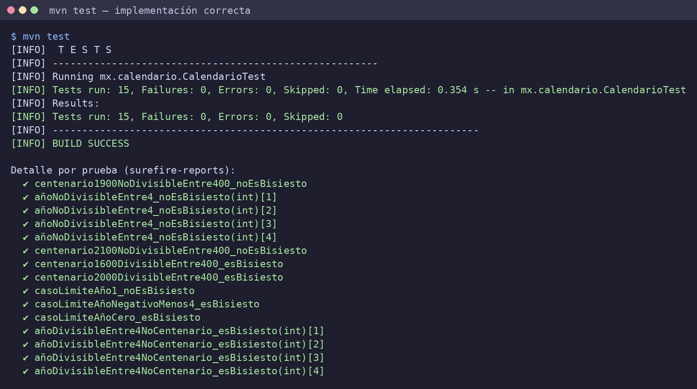
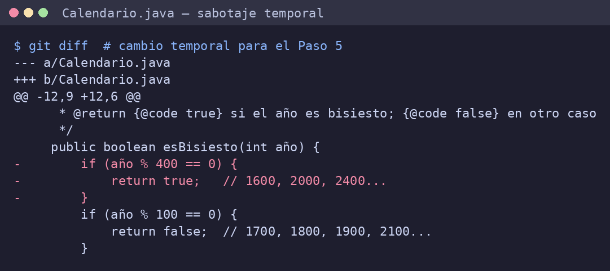
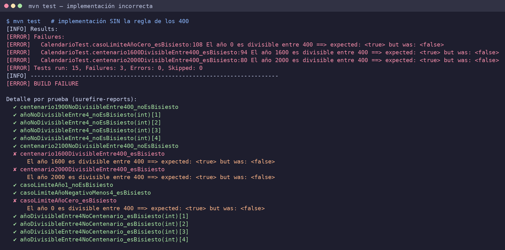

# Validador de año bisiesto

**Pruebas unitarias con JUnit 5 en Java** — Actividad 3.1

Alumno: Emmanuel Flores Noh

## 1. Preparación del proyecto (Paso 1)

Se creó un proyecto **Maven** (Java 21) con la dependencia de JUnit 5 (`junit-jupiter`, que incluye
`junit-jupiter-params` para las pruebas parametrizadas) y el plugin Surefire para ejecutar las pruebas
con `mvn test`.

```
validador-bisiesto/
├── pom.xml
└── src/
    ├── main/java/mx/calendario/Calendario.java
    └── test/java/mx/calendario/CalendarioTest.java
```

```xml
<dependency>
    <groupId>org.junit.jupiter</groupId>
    <artifactId>junit-jupiter</artifactId>
    <version>5.11.4</version>
    <scope>test</scope>
</dependency>
```

## 2. Clase `Calendario` (Paso 2)

```java
package mx.calendario;

/**
 * Utilidades del calendario gregoriano.
 */
public class Calendario {

    /**
     * Indica si un año es bisiesto según el calendario gregoriano.
     *
     * @param año año a evaluar
     * @return {@code true} si el año es bisiesto; {@code false} en otro caso
     */
    public boolean esBisiesto(int año) {
        if (año % 400 == 0) {
            return true;   // 1600, 2000, 2400...
        }
        if (año % 100 == 0) {
            return false;  // 1700, 1800, 1900, 2100...
        }
        return año % 4 == 0; // 2024, 1996...
    }
}
```


### ¿Por qué importa el orden de las comprobaciones?

Las reglas se solapan: todo múltiplo de 400 también lo es de 100 y de 4. Por eso se evalúa primero lo más
específico (÷400), luego la excepción (÷100) y al final la regla general (÷4). Si se comprobara primero
`año % 100 == 0`, el 2000 se rechazaría sin llegar a la regla de los 400; y si se comprobara primero
`año % 4 == 0`, el 1900 se aceptaría como bisiesto.

## 3. Plan de casos de prueba (Paso 3)

| Categoría | Años | Resultado esperado | Tipo de prueba |
|---|---|---|---|
| Divisible entre 4, no centenario | 1996, 2004, 2020, 2024 | bisiesto | `@ParameterizedTest` |
| No divisible entre 4 | 1999, 2001, 2023, 2025 | no bisiesto | `@ParameterizedTest` |
| Centenario no divisible entre 400 | 1900, 2100 | no bisiesto | `@Test` |
| Centenario divisible entre 400 | 1600, 2000 | bisiesto | `@Test` |
| Caso límite: año 0 | 0 | bisiesto (0 es divisible entre 400) | `@Test` |
| Caso límite: año negativo | -4 | bisiesto (en Java `-4 % 4 == 0`) | `@Test` |
| Caso límite: primer año | 1 | no bisiesto | `@Test` |

## 4. Clase `CalendarioTest` (Paso 4)

Se cumplen las indicaciones: `@ParameterizedTest` + `@ValueSource` para los casos simples, `@Test`
independiente para cada centenario, `assertTrue`/`assertFalse` con mensajes que muestran el año probado,
estructura AAA (*Arrange, Act, Assert*) en cada prueba y nombres que describen el comportamiento esperado,
sin `if`, bucles ni lógica condicional. En total se ejecutan **15 pruebas** (8 parametrizadas + 7 `@Test`).

```java
package mx.calendario;

import static org.junit.jupiter.api.Assertions.assertFalse;
import static org.junit.jupiter.api.Assertions.assertTrue;

import org.junit.jupiter.api.DisplayName;
import org.junit.jupiter.api.Test;
import org.junit.jupiter.params.ParameterizedTest;
import org.junit.jupiter.params.provider.ValueSource;

@DisplayName("Calendario.esBisiesto")
class CalendarioTest {

    @ParameterizedTest(name = "{0} es bisiesto")
    @ValueSource(ints = {1996, 2004, 2020, 2024})
    void añoDivisibleEntre4NoCentenario_esBisiesto(int año) {
        // Arrange
        Calendario calendario = new Calendario();

        // Act
        boolean resultado = calendario.esBisiesto(año);

        // Assert
        assertTrue(resultado,
                "El año " + año + " debería ser bisiesto");
    }

    @ParameterizedTest(name = "{0} no es bisiesto")
    @ValueSource(ints = {1999, 2001, 2023, 2025})
    void añoNoDivisibleEntre4_noEsBisiesto(int año) {
        // Arrange
        Calendario calendario = new Calendario();

        // Act
        boolean resultado = calendario.esBisiesto(año);

        // Assert
        assertFalse(resultado,
                "El año " + año + " no debería ser bisiesto");
    }

    @Test
    void centenario1900NoDivisibleEntre400_noEsBisiesto() {
        // Arrange
        Calendario calendario = new Calendario();
        int año = 1900;

        // Act
        boolean resultado = calendario.esBisiesto(año);

        // Assert
        assertFalse(resultado,
                "El año " + año + " no es divisible entre 400");
    }

    @Test
    void centenario2100NoDivisibleEntre400_noEsBisiesto() {
        // Arrange
        Calendario calendario = new Calendario();
        int año = 2100;

        // Act
        boolean resultado = calendario.esBisiesto(año);

        // Assert
        assertFalse(resultado,
                "El año " + año + " no es divisible entre 400");
    }

    @Test
    void centenario2000DivisibleEntre400_esBisiesto() {
        // Arrange
        Calendario calendario = new Calendario();
        int año = 2000;

        // Act
        boolean resultado = calendario.esBisiesto(año);

        // Assert
        assertTrue(resultado,
                "El año " + año + " es divisible entre 400");
    }

    @Test
    void centenario1600DivisibleEntre400_esBisiesto() {
        // Arrange
        Calendario calendario = new Calendario();
        int año = 1600;

        // Act
        boolean resultado = calendario.esBisiesto(año);

        // Assert
        assertTrue(resultado,
                "El año " + año + " es divisible entre 400");
    }

    @Test
    void casoLimiteAñoCero_esBisiesto() {
        // Arrange
        Calendario calendario = new Calendario();
        int año = 0; // divisible entre 400 (año astronómico 0 = 1 a.C.)

        // Act
        boolean resultado = calendario.esBisiesto(año);

        // Assert
        assertTrue(resultado,
                "El año " + año + " es divisible entre 400");
    }

    @Test
    void casoLimiteAñoNegativoMenos4_esBisiesto() {
        // Arrange
        Calendario calendario = new Calendario();
        int año = -4; // en Java -4 % 4 == 0

        // Act
        boolean resultado = calendario.esBisiesto(año);

        // Assert
        assertTrue(resultado,
                "El año " + año + " es divisible entre 4");
    }

    @Test
    void casoLimiteAño1_noEsBisiesto() {
        // Arrange
        Calendario calendario = new Calendario();
        int año = 1;

        // Act
        boolean resultado = calendario.esBisiesto(año);

        // Assert
        assertFalse(resultado,
                "El año " + año + " no es divisible entre 4");
    }
}
```

## 5. Evidencia de ejecución

### 5.1 Todas las pruebas pasan con la implementación correcta



### 5.2 Las pruebas detectan una implementación incorrecta (Paso 5)

Se modificó temporalmente `esBisiesto` eliminando la regla de los 400:



Al ejecutar de nuevo `mvn test`, fallan exactamente las pruebas que dependen de esa regla (1600, 2000 y el
caso límite del año 0), y el mensaje de cada aserción indica qué año se probó:



Después se restauró la versión correcta y las 15 pruebas volvieron a pasar (captura 5.1).

## 6. Revisión final (Paso 6)

- Cada prueba verifica una sola idea (una categoría de año o un caso límite).
- Los nombres de los métodos describen el comportamiento esperado (`centenario1900NoDivisibleEntre400_noEsBisiesto`).
- No hay `if`, bucles ni lógica condicional dentro de las pruebas.
- Todas las pruebas pasan con la implementación final (`Tests run: 15, Failures: 0`).
